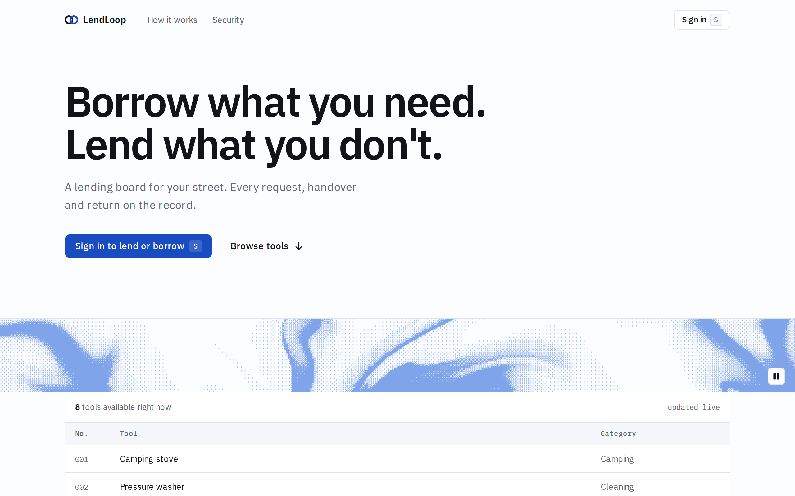
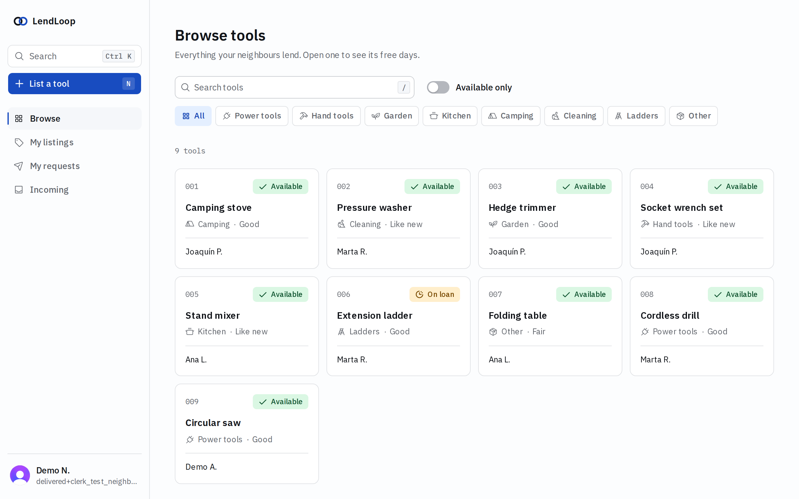
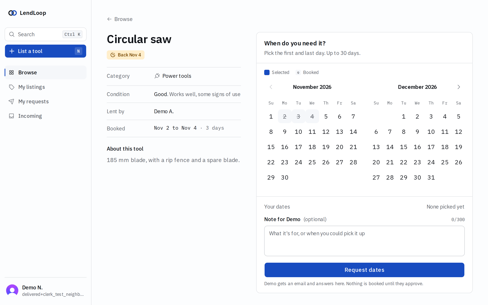
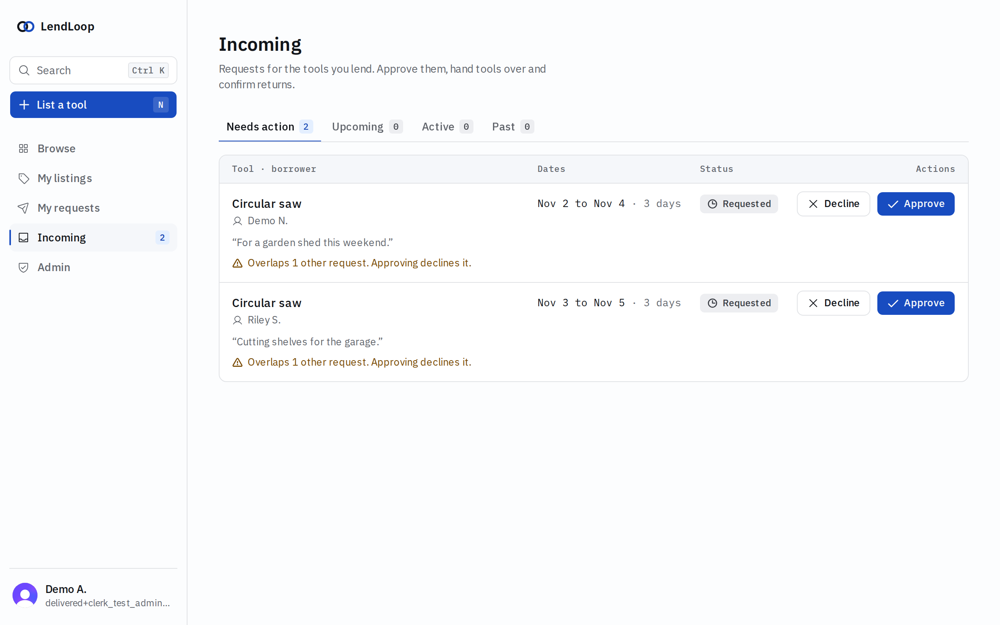
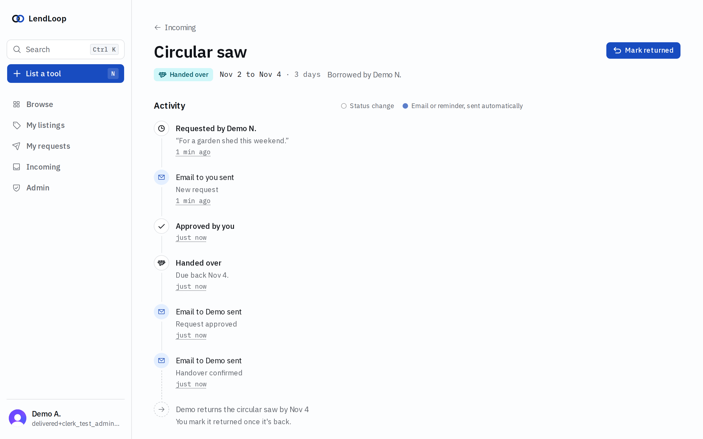
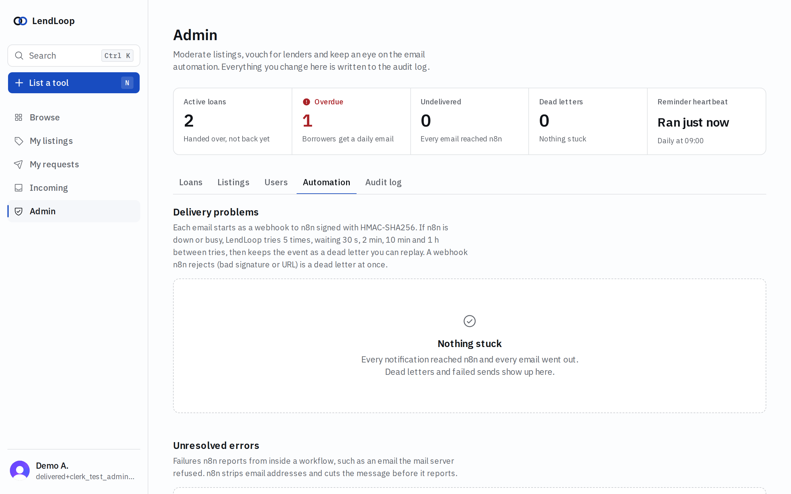
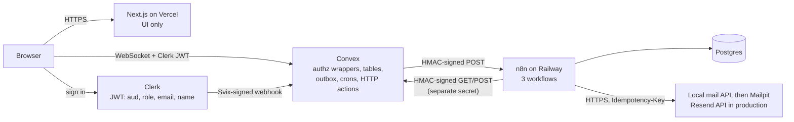
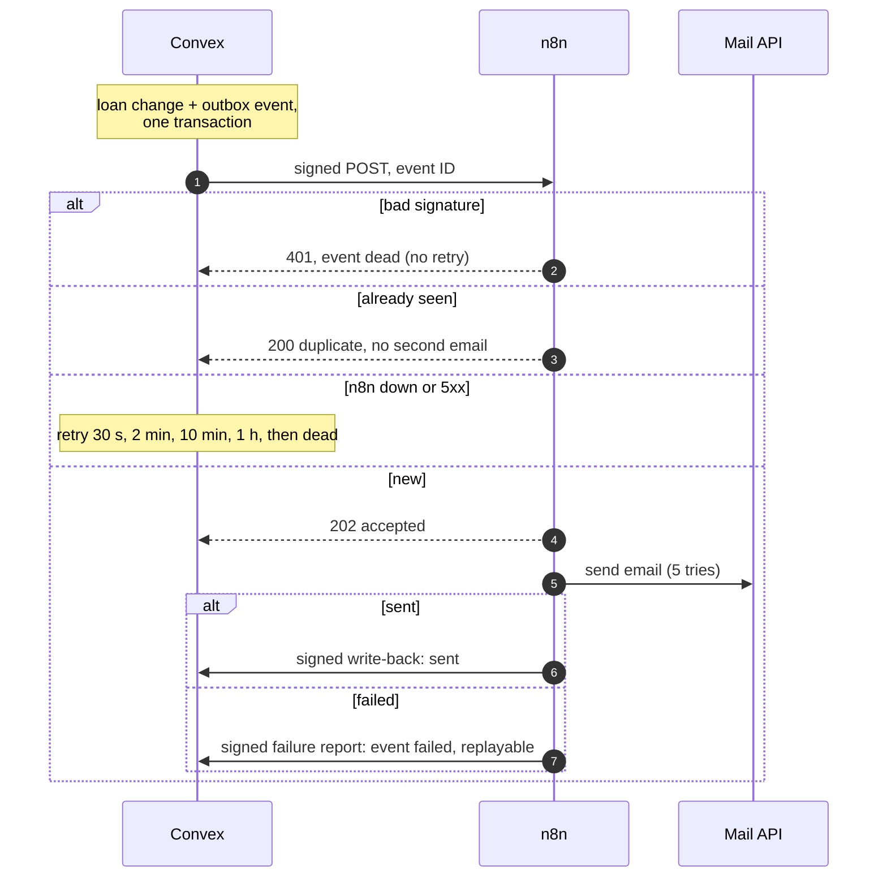
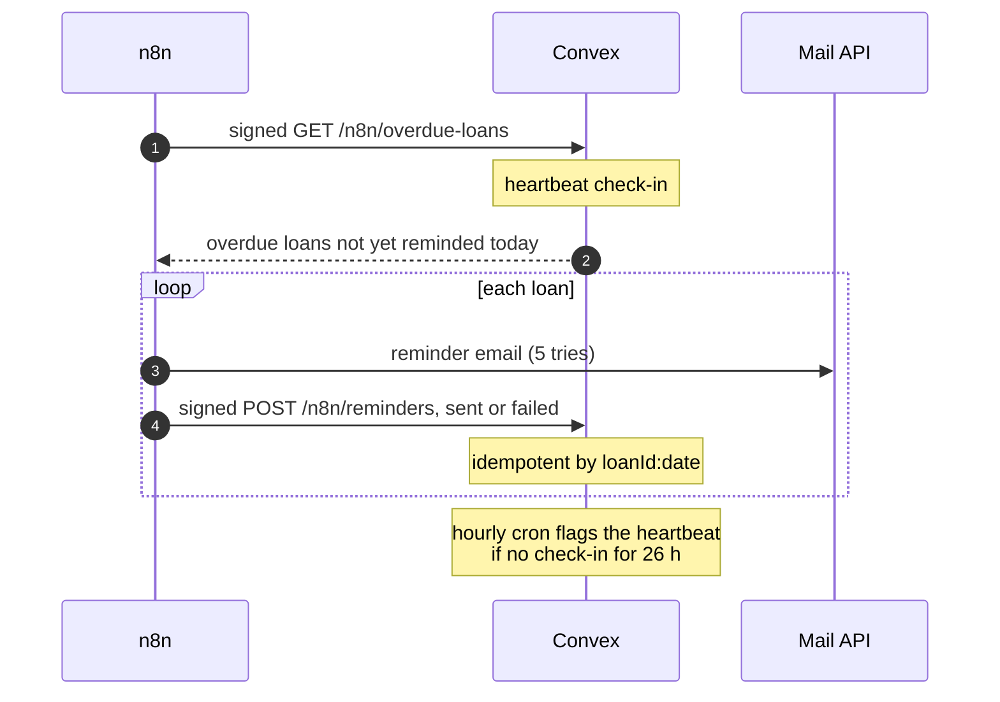

# LendLoop

**Borrow what you need. Lend what you don't.**

LendLoop is a tool-lending board for a neighbourhood. Neighbours list tools they are willing to lend, request each other's tools for a date range, and get email updates and overdue reminders sent by n8n. Owners approve, hand over and confirm returns; every step is on the record. It is built with Next.js (App Router), Clerk, Convex, n8n and TypeScript, with signed webhooks in both directions, role-based access enforced in one place, and as little personal data in motion as the job allows.

| | |
|---|---|
|  |  |
|  |  |
|  |  |

**Live demo:** <https://lendloop-steel.vercel.app>. Test accounts (an admin and a regular neighbour): credentials are in the submission email. Details in [docs/production.md](docs/production.md#live-demo).

## Contents

- [What it does](#what-it-does)
- [Architecture](#architecture)
- [How automation works](#how-automation-works)
- [Security and data minimization](#security-and-data-minimization)
- [Quickstart](#quickstart)
- [Scripts](#scripts)
- [Environment variables](#environment-variables)
- [Testing](#testing)
- [Production](#production)
- [Repository map](#repository-map)
- [Documentation](#documentation)

## What it does

- **Public landing page** with a live register of available tools (name and category only, no owners).
- **Browse and list tools** with categories, condition, availability ("Back Nov 12") and a Trusted Lender badge.
- **Request a loan** on a range calendar that shows booked days; an optional message goes to the owner only.
- **Owner inbox** (Needs action, Upcoming, Active, Past) with Approve, Decline, Hand over and Mark returned. Approving warns about, and auto-declines, overlapping requests.
- **Loan timeline** with every status change and every notification ("Queued", "Email sent", reminders).
- **Email notifications** for each step, and a **daily overdue reminder**, sent by n8n.
- **Admin console**: all loans, listings (remove with a reason), users (masked emails, Trusted toggle), automation health (outbox, dead letters with replay, errors, reminder heartbeat) and the audit log.
- Keyboard-first: `⌘K` command palette, `N` for a new listing; WCAG AA contrast on a single light theme.

## Architecture

Convex is the only enforcement point. Next.js renders UI; n8n sends email and reaches Convex only through signed, narrow endpoints. Full details in [docs/architecture.md](docs/architecture.md).



## How automation works

Every loan change writes an outbox event (IDs only) in the same transaction. A scheduled action builds the email payload at send time, signs it and posts it to n8n, retrying with backoff and marking it `dead` if n8n stays unreachable. n8n verifies, deduplicates, sends, and writes the result back. Contract, retries and the failure-mode table: [docs/integration.md](docs/integration.md).

**Loan notifications** (`loan-notifications`, webhook):



**Overdue reminders** (`overdue-reminders`, daily at 09:00):



A third workflow, `error-handler`, reports failed executions to Convex and falls back to an email to `OPS_EMAIL` when Convex is unreachable.

## Security and data minimization

- **Authorization in one place.** Every Convex function is built from wrappers in [`convex/lib/functions.ts`](convex/lib/functions.ts) (lint rule plus test). The [authorization matrix](docs/authz-matrix.md) is generated from tests that call every public function as anonymous, owner, borrower, another user and admin.
- **Role from a signed claim.** Admin comes from Clerk `publicMetadata.role` via the session token, read on every call, never stored. Admins cannot act on other people's loans.
- **Signed integration.** HMAC-SHA256 over timestamp, method, path and body; 300 s window; constant-time checks; a separate secret per direction; current and previous secrets accepted for rotation. Clerk webhooks are Svix-verified.
- **Minimal data.** Other neighbours see "Marta R."; admins see masked emails; the public page shows no user data. n8n receives only the recipient's own email and first names, built at send time. The borrower's message never leaves Convex.
- **Audit and logs.** Append-only audit log for every transition and admin action. Structured logs with emails and names redacted.
- **Hardening.** CSP and security headers, rate limits, 64 KB request caps, n8n with env access blocked in nodes and no stored data for successful runs, secrets only in env and n8n credentials.

Read more: [security and threat model](docs/security.md), [PII map](docs/pii-map.md), [known limitations](docs/security.md#known-limitations).

## Quickstart

Runs everything locally: Next.js and a Convex local deployment on your machine, n8n, Postgres, a local mail API and Mailpit in Docker.

### Prerequisites

- Node.js 24 and pnpm 12 (`corepack enable` picks up the version pinned in `package.json`)
- Docker with Compose v2
- A free Clerk account
- Free ports: 3000 (Next.js), 3210 and 3211 (Convex), 5678 (n8n), 8025 (Mailpit UI; `setup:local` picks the next free port if taken)

### 1. Install

```sh
pnpm install
cp .env.example .env.local
```

### 2. Clerk

1. Create a Clerk application (a development instance is fine).
2. Activate the **Convex integration** (Clerk dashboard → Integrations → Convex). Note the **Frontend API URL** it shows, for example `https://example-app-12.clerk.accounts.dev`.
3. Sessions → **Customize session token**, and set the claims:

   ```json
   {
     "aud": "convex",
     "role": "{{user.public_metadata.role}}",
     "email": "{{user.primary_email_address}}",
     "name": "{{user.full_name}}"
   }
   ```

   `aud` must be `convex` (Convex checks it as the `applicationID`); `role`, `email` and `name` are read by Convex on every call.
4. API keys: put the publishable key and secret key into `.env.local` as `NEXT_PUBLIC_CLERK_PUBLISHABLE_KEY` and `CLERK_SECRET_KEY`.

The Clerk webhook is optional locally (Clerk cannot reach `localhost`; users are synced from the token on sign-in). For a deployed instance, add an endpoint `<convex site URL>/clerk/webhook` for `user.updated` and `user.deleted`, and set its signing secret as `CLERK_WEBHOOK_SIGNING_SECRET` in Convex.

### 3. Convex local deployment

```sh
pnpm dev:convex
```

On the first run choose **Start without an account (run Convex locally)**, or log in and pick a local deployment. It writes `CONVEX_DEPLOYMENT` and the local URLs to `.env.local`, then reports that `CLERK_JWT_ISSUER_DOMAIN` is not set. In a second terminal, set it and enable the local-only dev tools:

```sh
pnpm exec convex env set CLERK_JWT_ISSUER_DOMAIN https://example-app-12.clerk.accounts.dev
pnpm exec convex env set ALLOW_DEV_TOOLS true   # local deployment only, never production
```

If `pnpm dev:convex` exited, start it again and leave it running for the next step.

### 4. Secrets and the automation stack

In the second terminal:

```sh
pnpm setup:local   # generates secrets into n8n/.env (mode 0600) and sets the Convex env vars
pnpm stack:up      # builds the n8n image; starts n8n, Postgres, the local mail API and Mailpit
```

`setup:local` prints key names, never values. It sets `N8N_WEBHOOK_URL`, `N8N_WEBHOOK_SECRET`, `CONVEX_INBOUND_SECRET`, `APP_URL` and `APP_TIMEZONE` on the Convex deployment. n8n starts with its three workflows imported, credentials created and everything active; no clicks needed. It also generates `MAIL_API_KEY` and removes the obsolete `SMTP_*` keys from an existing `n8n/.env`.

- n8n editor: <http://localhost:5678>, owner `owner@lendloop.local`, password in `n8n/.env` (`N8N_OWNER_PASSWORD`).
- Mailpit (all local email): <http://localhost:8025>.

### 5. Run

Stop `pnpm dev:convex`, then:

```sh
pnpm dev    # Next.js on :3000 and Convex together; the only command needed from now on
pnpm seed   # in the second terminal: fictional neighbours, tools and loans, including an overdue one
```

Open <http://localhost:3000> and sign in with your own account. Seeded neighbours cannot sign in; they are there so the board, inbox and reminders have data.

### 6. Make yourself admin

Clerk dashboard → Users → your user → Metadata → **Public** metadata:

```json
{ "role": "admin" }
```

The Admin item appears once the session token refreshes (within a minute; reload the page) or after signing out and in.

### 7. Check the automation end to end

```sh
pnpm e2e:automation
```

Prints a PASS/FAIL table against the running stack: email on request, write-back marks it sent, a repeated event ID is a duplicate, a forged signature gets 401, an overdue reminder is sent and recorded once per day, a mail failure (Mailpit chaos) reaches Convex as `failed`, and an admin replay delivers. It removes everything it created.

Reset the demo data at any time with `pnpm db:reset-demo`. Stop the stack with `pnpm stack:down`.

## Scripts

| Script | What it does |
|---|---|
| `pnpm dev` | Next.js and Convex dev together (`dev:next` + `dev:convex`) |
| `pnpm dev:next` / `pnpm dev:convex` | Either one alone |
| `pnpm build` / `pnpm start` | Production build and server |
| `pnpm lint` | ESLint (includes the rule that only `convex/lib/functions.ts` builds Convex functions) |
| `pnpm typecheck` | Next route types, then `tsc` for the app and for `convex/` |
| `pnpm test` / `pnpm test:watch` | Vitest: unit, `convex-test`, workflow lint and contract, static checks |
| `pnpm docs:authz` | Regenerate `docs/authz-matrix.md`; `pnpm docs:authz --check` fails if it is stale |
| `pnpm setup:local` | Generate local secrets into `n8n/.env` and set Convex env vars; `--rotate` rotates both HMAC secrets |
| `pnpm stack:up` / `pnpm stack:down` | Start or stop n8n, Postgres, the local mail API and Mailpit |
| `pnpm seed` | Idempotent fictional demo data (`seed:demo`) |
| `pnpm db:reset-demo` | Empty all app tables and re-seed (needs `ALLOW_DEV_TOOLS=true`) |
| `pnpm e2e:automation` | Automation E2E against the local stack |
| `pnpm e2e` | Playwright browser E2E (local only) |
| `pnpm convex:push` | Push Convex functions once without watching |

## Environment variables

Secrets are never committed: `.env.local` and `n8n/.env` are gitignored, and `n8n/.env` is written with mode 0600. Production values are set per platform.

### Next.js (`.env.local` locally, Vercel in production)

| Variable | Secret | Purpose |
|---|---|---|
| `NEXT_PUBLIC_CONVEX_URL` | no | Convex client URL. Written by `convex dev` locally; set by `convex deploy` during the Vercel build |
| `NEXT_PUBLIC_CONVEX_SITE_URL` | no | Convex HTTP actions URL, written by `convex dev`; not read by the app |
| `CONVEX_DEPLOYMENT` | no | Local deployment name, written by `convex dev` |
| `NEXT_PUBLIC_CLERK_PUBLISHABLE_KEY` | no | Clerk publishable key; its Frontend API host is also used to build the CSP |
| `CLERK_SECRET_KEY` | **yes** | Clerk server key for the Next.js server (and the Playwright suite's test users) |
| `CONVEX_DEPLOY_KEY` | **yes** | Vercel only: lets the build run `npx convex deploy` |
| `NEXT_PUBLIC_REPO_URL` | no | Optional. Repository URL; the landing page links to it and to `docs/security.md` |

### Convex deployment (`npx convex env set`; most set by `pnpm setup:local` locally)

| Variable | Secret | Purpose |
|---|---|---|
| `CLERK_JWT_ISSUER_DOMAIN` | no | Clerk Frontend API URL; Convex verifies JWTs against it |
| `CLERK_WEBHOOK_SIGNING_SECRET` | **yes** | Svix secret (`whsec_…`) for `/clerk/webhook`; the endpoint answers 503 without it |
| `N8N_WEBHOOK_URL` | no | n8n webhook, `…/webhook/lendloop-loan-events` |
| `N8N_WEBHOOK_SECRET` | **yes** | Signs Convex → n8n requests (at least 32 characters) |
| `N8N_WEBHOOK_SECRET_PREVIOUS` | **yes** | Written by `setup:local --rotate`; Convex signs with the current secret only, so it is informational here |
| `CONVEX_INBOUND_SECRET` | **yes** | Verifies n8n → Convex requests |
| `CONVEX_INBOUND_SECRET_PREVIOUS` | **yes** | Also accepted during a rotation |
| `APP_URL` | no | Public app URL used in email links (Vercel URL in production) |
| `APP_TIMEZONE` | no | IANA zone for "today", overdue and expiry; defaults to `UTC`; match `GENERIC_TIMEZONE` |
| `ALLOW_DEV_TOOLS` | no | `true` on the local deployment only; unlocks `db:reset-demo` and E2E clean-up. Never in production |

### n8n container (`n8n/.env` via `pnpm setup:local` locally, Railway variables in production)

| Variable | Secret | Purpose |
|---|---|---|
| `N8N_ENCRYPTION_KEY` | **yes** | Encrypts n8n credentials at rest; losing it makes them unreadable |
| `POSTGRES_PASSWORD` | **yes** | Local compose Postgres password (passed to n8n as `DB_POSTGRESDB_PASSWORD`) |
| `DB_TYPE`, `DB_POSTGRESDB_HOST`, `_PORT`, `_DATABASE`, `_USER`, `_PASSWORD` | password **yes** | n8n database; set by compose locally, from the Railway Postgres plugin in production |
| `LENDLOOP_N8N_WEBHOOK_SECRET` | **yes** | Credential that verifies Convex → n8n requests (Convex holds it as `N8N_WEBHOOK_SECRET`) |
| `LENDLOOP_N8N_WEBHOOK_SECRET_PREVIOUS` | **yes** | Previous value, also accepted during a rotation; falls back to the current secret when empty |
| `LENDLOOP_CONVEX_INBOUND_SECRET` | **yes** | Credential that signs n8n → Convex requests (Convex holds it as `CONVEX_INBOUND_SECRET`) |
| `LENDLOOP_CONVEX_INBOUND_SECRET_PREVIOUS` | **yes** | Kept in `n8n/.env` as the source for Convex's `CONVEX_INBOUND_SECRET_PREVIOUS`; n8n signs with the current one only |
| `N8N_OWNER_PASSWORD` | **yes** | Local file only; compose blanks it so only the hash enters the container. Not set on Railway |
| `N8N_INSTANCE_OWNER_PASSWORD_HASH` | **yes** | bcrypt hash of the owner password (`$` doubled for compose) |
| `N8N_INSTANCE_OWNER_EMAIL`, `_FIRST_NAME`, `_LAST_NAME` | no | Owner account provisioned from env (`N8N_INSTANCE_OWNER_MANAGED_BY_ENV=true`) |
| `GENERIC_TIMEZONE` | no | Zone of the 09:00 reminder schedule |
| `CONVEX_SITE_URL` | no | Convex HTTP actions URL as seen from n8n (`http://host.docker.internal:3211` locally, `https://<deployment>.convex.site` in production) |
| `MAIL_FROM` | no | Sender, for example `LendLoop <no-reply@lendloop.aido.lat>` |
| `OPS_EMAIL` | no | Receives the last-resort alert when Convex is unreachable |
| `MAIL_API_URL` | no | Base URL of the mail API that n8n POSTs `/emails` to (`http://mail-api:8080` locally, `https://api.resend.com` in production) |
| `MAIL_API_KEY` | **yes** | Bearer key for the mail API (random hex generated by `setup:local` locally; a sending-only Resend API key restricted to `lendloop.aido.lat` in production) |
| `MAILPIT_UI_PORT` | no | Local only: host port for the Mailpit UI |
| `WEBHOOK_URL` | no | Production only: n8n's public base URL |
| `N8N_SECURE_COOKIE` | no | `false` locally (plain HTTP), `true` in production |
| Hardening: `N8N_BLOCK_ENV_ACCESS_IN_NODE`, `EXECUTIONS_DATA_*`, `N8N_DIAGNOSTICS_ENABLED`, … | no | Baked into `n8n/Dockerfile`, so local and Railway share them. List and reasons in [security.md](docs/security.md#n8n-hardening) |

## Testing

| Layer | Command | What it covers |
|---|---|---|
| Unit | `pnpm test` | Pure rules in `convex/model` and `convex/lib` (state machine, overlap, dates and time zones, HMAC vectors, window and rotation, log redaction, payload allowlist, backoff) and UI helpers in `lib/` |
| Convex integration | `pnpm test` | `convex-test` on the edge runtime: the authorization matrix, transitions writing audit and outbox, auto-decline, rate limits, delivery with mocked `fetch` (2xx, 5xx backoff, 401 dead, timeouts), HTTP endpoints (bad or stale signature 401, 413, 415), Clerk webhook and deletion, expiry cron, heartbeat, admin replay |
| Static checks | `pnpm test`, `pnpm lint` | Only `lib/functions.ts` builds functions; `publicQuery` only for `tools.listPublic`; every public function is in the matrix |
| Workflow lint and contract | `pnpm test` | Exported n8n JSON: no secrets, allowlisted placeholders, retries, error workflow, raw body. The verification Code node runs against the shared HMAC vectors; every n8n → Convex body passes Convex's validator and signature check |
| Authorization doc | `pnpm docs:authz --check` | `docs/authz-matrix.md` matches the tested matrix |
| Automation E2E | `pnpm e2e:automation` | The real local stack (see [step 7](#7-check-the-automation-end-to-end)) |
| Browser E2E | `pnpm e2e` | Playwright with `@clerk/testing` and axe (see below) |

**Browser E2E.** The Playwright suite in `e2e/` runs Chromium against `pnpm dev:next` and `pnpm dev:convex`. It creates two Clerk test users (`+clerk_test` emails) through the Backend API, deletes them afterwards, and cleans its Convex data through `devtools:purgeE2E`. Specs: the public landing page shows no owner names and has no serious axe violations; an owner lists a tool, a borrower requests it, the owner approves from Incoming and the borrower's timeline shows Approved (axe on each page); a non-admin sees no Admin item and `/admin` says "Admins only"; `⌘K` opens the palette. Prerequisites: the Clerk keys in `.env.local`, `ALLOW_DEV_TOOLS=true` on the local deployment, and Playwright's Chromium (`pnpm exec playwright install chromium`).

**CI** (GitHub Actions, `.github/workflows/ci.yml`) runs on every push and pull request: install with the frozen lockfile, typecheck, lint, `pnpm test`, `pnpm docs:authz --check`, `pnpm build`, and gitleaks over the history. Dependabot updates npm packages and GitHub Actions weekly. The two E2E suites are not in CI because they need a Clerk instance and the Docker stack.

## Production

The demo runs on Vercel, a Convex production deployment, Railway (n8n and Postgres, same image as local) and the Resend email API with the sending domain `lendloop.aido.lat`. Clerk stays a development instance, because a production instance needs an owned app domain.

Before real users I would add, in order: a Clerk production instance; a secret manager with scheduled rotation; dedupe moved from n8n into Convex (n8n's history is capped at 10,000 event IDs); paging on dead letters, a stale heartbeat and `/health` (log drain, Sentry, uptime monitors); n8n queue mode with workers, backups and a private editor; a nonce-based CSP; retention and purge jobs; data export and erasure; tuned rate limits; an external penetration test; and neighbourhood tenancy. Reasoning and specifics: [docs/production.md](docs/production.md).

## Repository map

```
app/                 routes: (public) landing, (app) browse, listings, requests, incoming, loans, admin
components/          UI (shadcn-based, customized), admin console, loan and tool components
lib/                 UI helpers with tests
convex/              schema, functions (tools, loans, users, admin), lib/ (authz wrappers, HMAC,
                     logger, audit), model/ (pure rules), automation/ (outbox, delivery, contract,
                     inbound endpoints), http.ts, crons.ts, seed.ts, devtools.ts
n8n/                 Dockerfile, entrypoint.sh, local-mail-api.ts, workflows/*.json, .env.example
contracts/           HMAC test vectors shared by Convex and n8n tests
scripts/             setup.ts, e2e-automation.ts, authz-matrix.ts
tests/               authz matrix, n8n workflow lint and contract tests, static checks
e2e/                 Playwright specs
docs/                documentation (below); superpowers/ holds the design spec and plans
design/              UI direction comparison (directions.html)
DESIGN.md            locked design system
docker-compose.yml   local n8n, Postgres, mail API, Mailpit
```

## Documentation

| Document | What is in it |
|---|---|
| [docs/architecture.md](docs/architecture.md) | Components, trust boundaries, data flow, loan lifecycle, both workflows as sequence diagrams |
| [docs/integration.md](docs/integration.md) | Contract v1: endpoints, headers, canonical string, payload examples, retries, idempotency, error workflow, heartbeat, failure modes, replay |
| [docs/security.md](docs/security.md) | STRIDE-lite threat model mapped to files and tests, RBAC, secrets, signing, rate limits, CSP, logging, known limitations |
| [docs/pii-map.md](docs/pii-map.md) | Every personal field: where it lives, who sees it, whether it reaches n8n or logs, retention, deletion |
| [docs/authz-matrix.md](docs/authz-matrix.md) | Generated authorization matrix |
| [docs/runbook.md](docs/runbook.md) | Rotate secrets, replay dead letters, stale heartbeat, n8n down, 401s, bounces, reset the demo |
| [docs/production.md](docs/production.md) | What I would change for production, live demo details |
| [docs/adr/](docs/adr/) | Eleven short decision records (deployment, roles, lifecycle, email, outbox, signing, data minimization, n8n secrets, user sync, UI direction, email through the Resend API) |
| [DESIGN.md](DESIGN.md) | Design system tokens and rules |

### How this was built

The design was brainstormed and written down before any code: the [design spec](docs/superpowers/specs/2026-10-31-lendloop-design.md) records every decision (D1 to D13), the spikes that de-risked them (§15) and the follow-ups (§16). Implementation followed four plans in [docs/superpowers/plans/](docs/superpowers/plans/): backend core, automation (Convex side, then n8n), UI, and hardening with deployment. They are kept as the decision record.
