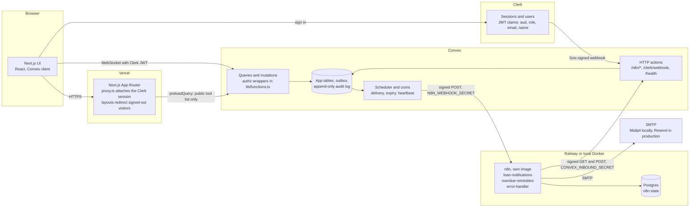
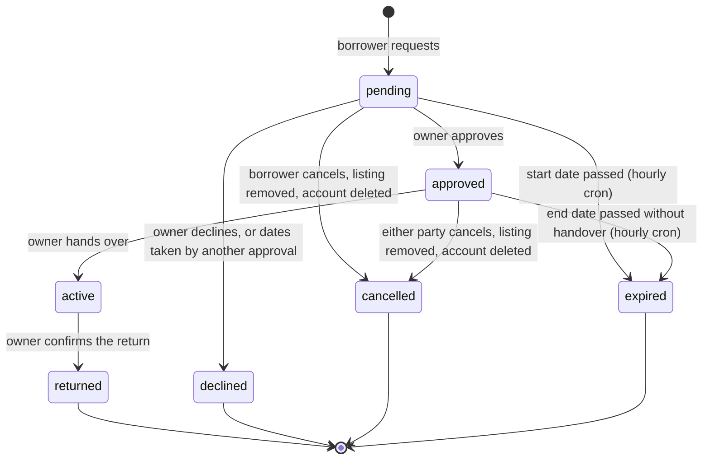
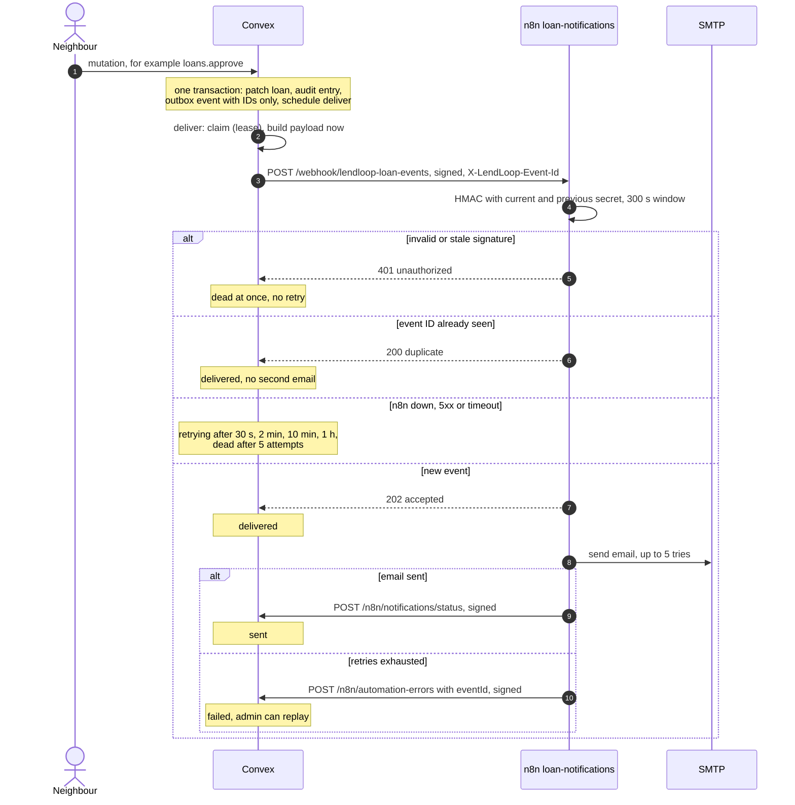
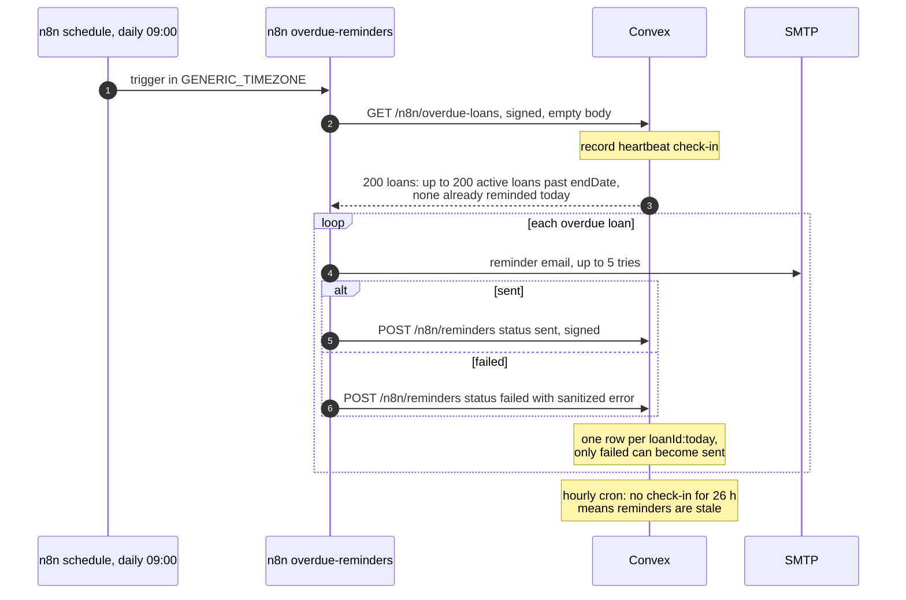

# Architecture

LendLoop is a Next.js app on Vercel, a Convex backend, Clerk for identity, and n8n (with Postgres) for email automation. **Convex is the only enforcement point:** Next.js renders UI and redirects signed-out visitors, n8n sends email, and neither decides permissions. n8n has no database access; it reaches Convex only through four signed, narrowly scoped HTTP endpoints.

Related: [integration contract](integration.md), [security](security.md), [PII map](pii-map.md), [ADRs](adr/).

## Components



| Component | Responsibility | Code |
|---|---|---|
| Next.js 16 (App Router) | UI only. `proxy.ts` runs `clerkMiddleware()` with no route rules; `app/(app)/layout.tsx` calls `auth.protect()` as a UX redirect. Security headers and CSP in `next.config.ts`. | `app/`, `components/`, `lib/`, `proxy.ts` |
| Clerk | Sign-in, sessions, user records. The session token carries `aud: "convex"` plus `role`, `email` and `name` claims. | Clerk dashboard; `convex/auth.config.ts` |
| Convex functions | Every read and write. Authentication and roles are resolved by the wrappers in `convex/lib/functions.ts`; nothing else may build a public function. | `convex/tools.ts`, `loans.ts`, `users.ts`, `admin.ts` |
| Domain model | Pure rules with no Convex imports: loan state machine, overlap, dates, delivery backoff, heartbeat staleness. | `convex/model/` |
| Outbox | Notification events (IDs only), delivered by a scheduled action with retries and dead letters. | `convex/automation/outbox.ts`, `delivery.ts`, `payloads.ts` |
| HTTP actions | Signed endpoints for n8n, the Svix-verified Clerk webhook, and `/health`. | `convex/http.ts`, `convex/automation/inbound.ts`, `convex/clerkWebhook.ts` |
| Crons | Hourly loan expiry (minute 5) and heartbeat check (minute 15). | `convex/crons.ts` |
| n8n | Three workflows exported to git, imported and published by the image's entrypoint on every start. Secrets live in n8n credentials. | `n8n/Dockerfile`, `n8n/entrypoint.sh`, `n8n/workflows/` |
| Postgres | n8n's database: credentials (encrypted), workflows, error executions (7 days), dedupe history. | `docker-compose.yml` locally; Railway plugin in production |
| SMTP | Mailpit locally (web UI on port 8025); Resend SMTP with the sending domain `lendloop.aido.lat` in production. | `n8n/.env` |

### Runtime topology

| | Next.js | Convex | n8n | Mail |
|---|---|---|---|---|
| Local | `pnpm dev`, port 3000 | local deployment (`convex dev`), API 3210, HTTP actions 3211 | `pnpm stack:up` (Docker Compose), port 5678 | Mailpit, UI 8025, SMTP 1025 inside the compose network |
| Demo | Vercel | Convex production deployment | Railway, same image, Railway Postgres | Resend SMTP |

Locally, Convex reaches n8n at `http://localhost:5678` and n8n (in Docker) reaches Convex at `http://host.docker.internal:3211` (`extra_hosts: host-gateway`). A cloud Convex deployment cannot reach `localhost`, which is why local development uses a Convex local deployment ([ADR 0001](adr/0001-deployment-topology.md)).

## Trust boundaries

| Boundary | Authenticated by | Authorized by | Notes |
|---|---|---|---|
| Browser → Next.js | Clerk session cookie | nothing (UI only) | Layout redirects are UX, not security |
| Browser → Convex | Clerk JWT, verified by Convex against `CLERK_JWT_ISSUER_DOMAIN` with `applicationID: "convex"` (the `aud` claim) | wrappers: `userQuery`, `adminMutation`, … and per-resource checks | Role read from the token on every call, never stored |
| Next.js server → Convex | none | `tools.listPublic` is the only public function | Landing page preload only |
| Clerk → Convex `/clerk/webhook` | Svix signature (`CLERK_WEBHOOK_SIGNING_SECRET`) | event type allowlist (`user.updated`, `user.deleted`) | Rate limited |
| Convex → n8n | HMAC with `N8N_WEBHOOK_SECRET`, 300 s window, method and path bound | n8n accepts only the one webhook path | Payload built at send time, allowlisted fields |
| n8n → Convex `/n8n/*` | HMAC with `CONVEX_INBOUND_SECRET` (separate secret), same rules | each endpoint does one narrow thing and re-validates its input | Rate limited, 64 KB cap |
| n8n → SMTP | SMTP credential in n8n | provider | TLS (port 465) in production |
| Uptime monitor → `/health` | none | none | Returns `{"ok":true}` and nothing else |
| Vercel build → Convex | `CONVEX_DEPLOY_KEY` | deploy only | Build-time secret |

## Data flow: from a request to an email

1. A signed-in borrower picks dates on a tool and submits. The browser calls the `loans.request` mutation over the Convex WebSocket with the Clerk JWT.
2. `userMutation` verifies the token, loads the caller's `users` row and role. The handler validates the range (`convex/model/dates.ts`) and message, enforces the rate limit (10 per hour per user), checks overlap with approved or active loans and for an existing pending request, inserts the loan, writes an audit entry and enqueues a `loan.requested` event for the owner. All of this is one transaction.
3. The scheduler runs `deliver`, which claims the event, builds the payload from current data (owner's email and first name, borrower's first name, tool name, dates, link), signs it and POSTs it to n8n.
4. n8n verifies the signature, deduplicates by event ID, answers 202, composes a plain-text email and sends it over SMTP.
5. n8n posts a signed write-back; Convex marks the event `sent`. The loan timeline shows "Email sent" instead of "Queued".
6. The owner approves. `applyLoanTransition` (the only way a loan changes status) patches the loan, audits, enqueues `loan.approved`, and in the same transaction auto-declines overlapping pending requests, each with its own audit entry and `loan.declined` event.

## Loan lifecycle

The state machine is a pure table in [`convex/model/loanMachine.ts`](../convex/model/loanMachine.ts); every status change goes through [`applyLoanTransition`](../convex/lib/loanTransitions.ts), which validates, patches, audits and enqueues notifications in the caller's transaction. Overdue is derived (`active` and today after `endDate` in `APP_TIMEZONE`), never stored ([ADR 0003](adr/0003-loan-lifecycle.md)).



Rules worth knowing:

- Only the owner hands over and marks returned. The borrower cannot self-declare a return.
- At most one active loan per tool; hand-over is refused while another loan is out, and after the booking's end date.
- Nobody can cancel an active loan. Removing a listing is blocked while a loan is active; admin removal leaves the active loan running and cancels only open requests.
- Convex mutations are serializable. Two racing approvals for overlapping dates cannot both commit; the loser retries, sees the conflict and fails with `CONFLICT`.

## Workflow: loan notifications



## Workflow: overdue reminders



## Failure handling

The full failure-mode table, with the test or E2E step that proves each row, is in [integration.md](integration.md#failure-modes). In short:

- **Convex → n8n** never loses an event silently: it is retried with backoff, then marked `dead` and shown in the admin console with a replay button.
- **n8n → SMTP** failures come back to Convex with the event ID, so the event is `failed` and replayable.
- **n8n → Convex** failures go to the error workflow, which reports to Convex or, if Convex is unreachable, emails `OPS_EMAIL`.
- **A schedule that never runs** is caught by the Convex heartbeat check, because nothing else can report it.

## Repository layout

```
app/                  App Router routes: (public) landing, (app) signed-in area
components/           UI components (shadcn-based, customized), admin console
lib/                  UI helpers (formatting, status labels, error messages), tested
convex/
  schema.ts           tables and indexes
  lib/                functions.ts (authz wrappers), hmac.ts, logger.ts, audit.ts,
                      loanTransitions.ts, rateLimits.ts, integrationConfig.ts, ...
  model/              pure domain rules: loanMachine, overlap, dates, delivery, heartbeat
  automation/         contract.ts, outbox.ts, delivery.ts, payloads.ts, inbound.ts,
                      reminders.ts, notifications.ts, errors.ts, heartbeat.ts
  tools.ts loans.ts users.ts admin.ts
  http.ts clerkWebhook.ts crons.ts seed.ts devtools.ts
contracts/            hmac-vectors.json, shared by Convex and n8n tests
n8n/                  Dockerfile, entrypoint.sh, workflows/*.json, .env.example
scripts/              setup.ts (secrets and env wiring), e2e-automation.ts, authz-matrix.ts
tests/                authz matrix, n8n workflow lint and contract tests, static checks
e2e/                  Playwright specs (pnpm e2e, local only)
docs/                 this documentation; superpowers/ holds the design spec and plans
design/               directions.html, the UI direction comparison
docker-compose.yml    local n8n, Postgres and Mailpit
```
