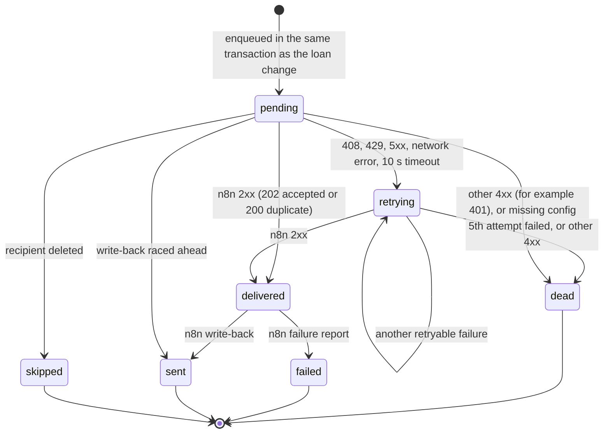
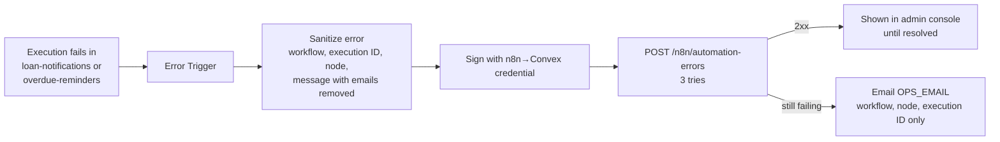

# Integration: Convex and n8n

This is the wire contract between Convex and n8n, and how delivery stays reliable when either side fails. The source of truth is code: [`convex/automation/contract.ts`](../convex/automation/contract.ts) (constants, payload types, validators), [`convex/lib/hmac.ts`](../convex/lib/hmac.ts) (signing), [`convex/automation/delivery.ts`](../convex/automation/delivery.ts) (outbox delivery) and the exported workflows in [`n8n/workflows/`](../n8n/workflows/).

Related: [architecture](architecture.md) for the big picture, [runbook](runbook.md) for operations, [ADR 0005](adr/0005-transactional-outbox.md) and [ADR 0006](adr/0006-hmac-both-directions.md) for the reasoning.

## Contents

- [Endpoints](#endpoints)
- [Signing](#signing)
- [Payloads (contract v1)](#payloads-contract-v1)
- [Delivery, retries and dead letters](#delivery-retries-and-dead-letters)
- [Idempotency](#idempotency)
- [Error workflow](#error-workflow)
- [Heartbeat](#heartbeat)
- [Failure modes](#failure-modes)
- [Replay](#replay)
- [Changing the contract](#changing-the-contract)

## Endpoints

Convex calls one n8n webhook. n8n calls four Convex HTTP actions. n8n has no database access and no Convex deploy key; these signed endpoints are all it can reach.

| Direction | Method and path | Purpose | Secret |
|---|---|---|---|
| Convex → n8n | `POST /webhook/lendloop-loan-events` | One notification event | `N8N_WEBHOOK_SECRET` |
| n8n → Convex | `GET /n8n/overdue-loans` | Overdue loans to remind today; records the heartbeat | `CONVEX_INBOUND_SECRET` |
| n8n → Convex | `POST /n8n/reminders` | Result of one reminder email | `CONVEX_INBOUND_SECRET` |
| n8n → Convex | `POST /n8n/notifications/status` | "The email for this event was sent" | `CONVEX_INBOUND_SECRET` |
| n8n → Convex | `POST /n8n/automation-errors` | A sanitized failure report | `CONVEX_INBOUND_SECRET` |
| uptime monitor → Convex | `GET /health` | Liveness, returns `{"ok":true}` and nothing else | none |

Routes are declared in [`convex/http.ts`](../convex/http.ts). Every n8n → Convex route is wrapped by `signedEndpoint` in [`convex/automation/inbound.ts`](../convex/automation/inbound.ts), so no route can skip a check. The checks run in this order:

| Check | Response on failure |
|---|---|
| Global token bucket `inboundHttp` (120 per minute, burst 240) | `429 {"error":"rate_limited"}` |
| `Content-Length` over 64 KB | `413 {"error":"too_large"}` |
| POST without `application/json` | `415 {"error":"unsupported_media_type"}` |
| Actual body over 64 KB | `413 {"error":"too_large"}` |
| No inbound secret configured (or shorter than 32 characters) | `503 {"error":"not_configured"}` |
| Signature, timestamp window, method and path | `401 {"error":"unauthorized"}` |
| Body is not JSON, or fails the Convex validator | `400 {"error":"invalid_body"}` |
| Handler throws | `500 {"error":"internal"}` (details only in redacted logs) |

Error bodies are fixed strings. The reason for a 401 (`missing`, `stale` or `mismatch`) is logged as `inbound.rejected` but never sent back.

## Signing

Both directions use the same scheme, implemented once in Convex ([`convex/lib/hmac.ts`](../convex/lib/hmac.ts)) and once in n8n Code nodes, and tested against the same vectors ([`contracts/hmac-vectors.json`](../contracts/hmac-vectors.json)).

### Headers

| Header | Value | Direction |
|---|---|---|
| `X-LendLoop-Timestamp` | Unix time in seconds, exactly 10 digits | both |
| `X-LendLoop-Signature` | `v1=<64 lowercase hex>`; several comma-separated `v1=` values are accepted | both |
| `X-LendLoop-Event-Id` | Outbox event ID | Convex → n8n only |

### Canonical string

```
<timestamp>.<METHOD>.<path>.<raw body>
```

- `METHOD` is upper case. `path` is the URL path only (no host, no query), for example `/n8n/reminders` or `/webhook/lendloop-loan-events`.
- The body is the exact bytes sent, read as UTF-8. A GET has an empty body, so its canonical string ends with a dot: `1793620801.GET./n8n/overdue-loans.`
- The signature is `hex(HMAC-SHA256(secret, canonical))`.

Binding the method and path means a captured signature for one endpoint is useless against another (`convex/http.test.ts`: "a signature for one path can't be replayed on another").

### Verification rules

| Rule | Convex | n8n (`loan-notifications`) |
|---|---|---|
| Timestamp window | `abs(now - ts) <= 300 s` | same |
| Comparison | `crypto.subtle.verify` (constant time) | hand-written constant-time loop over every provided `v1=` value, no early exit |
| Secrets accepted | `CONVEX_INBOUND_SECRET` and `CONVEX_INBOUND_SECRET_PREVIOUS` | current and previous Convex→n8n credentials (`LENDLOOP_N8N_WEBHOOK_SECRET`, `LENDLOOP_N8N_WEBHOOK_SECRET_PREVIOUS`) |
| Minimum secret length | 32 characters; shorter values are ignored | not enforced; `pnpm setup:local` generates 32 random bytes (64 hex characters) |
| Path | taken from the request URL | fixed in the Code node, never read from the request |
| Event ID | n/a | must be present in the signed body and equal the (unsigned) `X-LendLoop-Event-Id` header |

n8n computes the expected HMACs with Crypto nodes that read the secrets from n8n credentials, so the Code nodes never see a secret and need no `crypto` builtin ([ADR 0008](adr/0008-n8n-secrets-in-credentials.md)).

### Rotation

Signers always use the current secret. Verifiers accept the current and the previous one, so a secret can change without dropping requests, provided the verifier learns the new secret before the signer starts using it. The step-by-step procedure, including the order that matters, is in the [runbook](runbook.md#rotate-the-hmac-secrets).

## Payloads (contract v1)

### Notification event (Convex → n8n)

Built at send time by [`buildNotificationPayload`](../convex/automation/payloads.ts), never stored. The outbox row only holds IDs ([ADR 0007](adr/0007-ids-only-outbox.md)).

```http
POST /webhook/lendloop-loan-events
Content-Type: application/json
X-LendLoop-Timestamp: 1793963520
X-LendLoop-Signature: v1=3f1c0d8e5b7a9c2e4d6f8a0b1c3e5d7f9a2b4c6d8e0f1a3b5c7d9e2f4a6b8c0d
X-LendLoop-Event-Id: k57c2d9e4f1g6h3j8k5m0n2p7q4r9s1t
```

```json
{
  "schemaVersion": 1,
  "eventId": "k57c2d9e4f1g6h3j8k5m0n2p7q4r9s1t",
  "type": "loan.approved",
  "occurredAt": "2026-11-06T11:02:00.412Z",
  "recipient": { "email": "ana@example.com", "firstName": "Ana" },
  "tool": { "name": "Cordless drill" },
  "loan": {
    "id": "jx74b8n2m6q1r5t9v3w7y0z4a8c2e6g1",
    "status": "approved",
    "startDate": "2026-11-08",
    "endDate": "2026-11-12"
  },
  "counterpartFirstName": "Marta",
  "actionUrl": "https://lendloop.example.com/loans/jx74b8n2m6q1r5t9v3w7y0z4a8c2e6g1"
}
```

(IDs and the signature are illustrative.)

| Field | Notes |
|---|---|
| `eventId` | Outbox event ID; n8n's dedupe key |
| `type` | One of the event types below |
| `occurredAt` | ISO 8601 creation time of the outbox event |
| `recipient` | The recipient's own email and first name only |
| `tool.name` | `"a tool"` if the tool no longer exists |
| `loan` | `null` for events without a loan (an admin removing a listing notifies its owner) |
| `loan.status` | Status **at send time**, which can differ from the status that caused the event (see [Replay](#replay)) |
| `counterpartFirstName` | The other party's first name; `null` without a loan or when that account was deleted |
| `actionUrl` | `APP_URL/loans/<id>`, or `APP_URL/me/listings` without a loan |

Never included: last names, the counterpart's email, the borrower's message, tool descriptions, internal user IDs. `PAYLOAD_KEYS` in `contract.ts` is the allowlist, and `convex/automation/payloads.test.ts` ("payload carries only allowlisted fields") fails if the builder emits anything else.

If the recipient was deleted (or has no email) when the event is sent, no payload is built and the event becomes `skipped`.

| Event type | Recipient | Raised by |
|---|---|---|
| `loan.requested` | owner | borrower requests |
| `loan.approved` | borrower | owner approves |
| `loan.declined` | borrower | owner declines, or approval of an overlapping request auto-declines it (`dates_taken`) |
| `loan.cancelled` | the other party | either party cancels; a borrower's account is deleted (owner is told) |
| `loan.handed_over` | borrower | owner hands over |
| `loan.returned` | borrower | owner marks returned |
| `loan.expired` | borrower; also the owner if the loan was approved but never handed over | hourly expiry cron |
| `listing.removed` | each borrower with an open request; the owner too when an admin removed it | owner removes a listing, admin moderation, owner account deleted |

The response from n8n is one of three fixed bodies:

| Response | Meaning | Convex records |
|---|---|---|
| `202 {"accepted":true}` | Verified, new event; n8n now owns the send | `delivered` |
| `200 {"duplicate":true}` | Verified, event ID already seen; nothing sent | `delivered` |
| `401 {"error":"unauthorized"}` | Missing, stale or wrong signature, or malformed body | `dead` (no retry) |

n8n answers 202 **before** sending. If it deduplicated first and then failed to send, Convex's retry would be dropped as a duplicate and the email lost silently. Accepting after verify and dedupe makes n8n responsible for the send; it then reports success (write-back) or failure (failure report).

### Overdue loans (n8n → Convex)

`GET /n8n/overdue-loans` (signed, empty body) returns at most 200 active loans with `endDate` before today in `APP_TIMEZONE`, minus loans that already have a `sent` reminder today and loans whose borrower was deleted:

```json
{
  "loans": [
    {
      "loanId": "jd71x4b8n2m6q1r5t9v3w7y0z4a8c2e6",
      "idempotencyKey": "jd71x4b8n2m6q1r5t9v3w7y0z4a8c2e6:2026-11-06",
      "borrower": { "email": "joaquin@example.com", "firstName": "Joaquín" },
      "tool": { "name": "Extension ladder" },
      "endDate": "2026-11-03",
      "daysOverdue": 3
    }
  ]
}
```

### Reminder result (n8n → Convex)

`POST /n8n/reminders`, one call per loan:

```json
{ "loanId": "jd71x4b8n2m6q1r5t9v3w7y0z4a8c2e6", "idempotencyKey": "jd71x4b8n2m6q1r5t9v3w7y0z4a8c2e6:2026-11-06", "status": "sent", "executionId": "1287" }
```

A failed send adds `"status": "failed"` and `"error"` (emails stripped, at most 300 characters). Convex answers `200 {"accepted":true,"duplicate":false}`, or `200 {"accepted":true,"duplicate":true}` for a repeat. It answers `422 {"error":"rejected"}` when the key is not `<loanId>:<today>` for a real loan that is `active` or `returned` (it may have been returned since the fetch), so n8n cannot write reminders for arbitrary loans or days.

### Notification status (n8n → Convex)

`POST /n8n/notifications/status` after the email was sent:

```json
{ "eventId": "k57c2d9e4f1g6h3j8k5m0n2p7q4r9s1t", "status": "sent", "executionId": "1288" }
```

Answers `200 {"found":true,"updated":true}`, `200 {"found":true,"updated":false}` (already `sent`, or `skipped`), or `404 {"error":"not_found"}`. The write-back can arrive before Convex has recorded `delivered`; `markDelivered` never downgrades `sent` or `failed`.

### Automation error (n8n → Convex)

`POST /n8n/automation-errors`:

```json
{ "workflow": "loan-notifications", "executionId": "1289", "node": "Send email", "message": "451 Temporary failure for [email]", "eventId": "k57c2d9e4f1g6h3j8k5m0n2p7q4r9s1t" }
```

`eventId` is present only when the reporting node knows it (the failure branch of `loan-notifications`). Convex stores the error (message sanitized again, at most 500 characters), deduplicated by `executionId`, and marks the event `failed` unless it is already `sent`. Answers `200 {"duplicate":false}` or `200 {"duplicate":true}`.

## Delivery, retries and dead letters



1. **Enqueue.** `enqueueEvent` ([`convex/automation/outbox.ts`](../convex/automation/outbox.ts)) inserts the outbox row and schedules `deliver` with `ctx.scheduler.runAfter(0, …)` inside the mutation that changed the loan. Scheduling is atomic with the commit: no commit, no event; commit, a guaranteed attempt.
2. **Claim.** `claim` exits unless the event is `pending` or `retrying`, increments `attempts` and takes a 60-second lease (`nextAttemptAt`), so two concurrent deliveries cannot both send.
3. **Config.** Missing or invalid `N8N_WEBHOOK_URL`, or `N8N_WEBHOOK_SECRET` under 32 characters, marks the event `dead` with a readable `lastError`, without calling n8n.
4. **Build, sign, POST** with a 10-second timeout.
5. **Classify** ([`convex/model/delivery.ts`](../convex/model/delivery.ts)):

| n8n answer | Outcome |
|---|---|
| 2xx | `delivered` |
| 408, 429, 5xx, network error, timeout | `retrying`, next attempt after the backoff below |
| any other 4xx (a rejected signature means broken configuration) | `dead` at once, no retry storm |

**Backoff.** At most 5 attempts in total. The waits after attempts 1 to 4 are 30 s, 2 min, 10 min and 1 h, so an event that never gets through is `dead` about 73 minutes after the first attempt. (`BACKOFF_MS` lists a fifth value, 6 h, that the 5-attempt cap never reaches.)

**Dead letters.** `dead` and `failed` events show in the admin console (Automation tab) with their sanitized `lastError`, and are logged as `outbox.dead`. They stay until an admin replays them. Nobody is paged; see [production](production.md#observability).

Inside n8n, network nodes (including the three that send email through the mail API) have Retry On Fail:

| Node | Tries | Wait | When exhausted |
|---|---|---|---|
| `Send email` (loan-notifications), HTTP request to the mail API | 5 | 5 s | error output → signed failure report with the event ID → event `failed` |
| `Send reminder` (overdue-reminders), HTTP request to the mail API | 5 | 5 s | error output → reminder recorded `failed` |
| HTTP requests to Convex (write-backs, overdue GET, error report) | 3 | 2 s | execution fails → error workflow |
| `Email ops` (error-handler), HTTP request to the mail API | 5 | 5 s | nothing further |

The failure report and the `Mark failed` write-back include the mail API's response body (for example `SMTP 451 …` locally, or Resend's error) with email addresses replaced by `[email]`.

`tests/n8n/workflows.test.ts` fails if any HTTP node loses its retry settings, or if a main workflow stops routing to the error handler.

## Idempotency

| What | Key | Where enforced | Effect of a repeat |
|---|---|---|---|
| Notification event | outbox event ID | n8n Remove Duplicates (workflow scope, kept in n8n's Postgres, `historySize` 10,000) | `200 {"duplicate":true}`, no second email |
| Email send (notification) | `Idempotency-Key: lendloop-<eventId>` | mail API (Resend; the local mail API implements the same rules) | same key and payload within 24 h returns the original response, no second email; same key with a different payload is `409` |
| Email send (reminder) | `Idempotency-Key: lendloop-reminder-<loanId>:<YYYY-MM-DD>` | mail API | as above |
| Email send (ops alert) | `Idempotency-Key: lendloop-ops-<failed executionId>` | mail API | as above |
| Reminder | `<loanId>:<YYYY-MM-DD>`, today in `APP_TIMEZONE` | `recordReminder` (unique by key); the overdue GET skips loans with a `sent` reminder today | no duplicate row; only `failed → sent` upgrades are allowed |
| Notification status | event ID + status | `recordNotificationStatus` | already `sent` (or `skipped`) is a no-op |
| Automation error | n8n execution ID | `recordError` (unique by `executionId`) | `{"duplicate":true}` |
| Clerk webhook | Clerk user ID | upsert and anonymize are naturally idempotent; `user.updated` is ignored for deleted users | no change |
| Admin replay | none, on purpose | each replay is a new event ID | a second replay sends a second email |

The email keys matter for n8n's 5 retries: if an attempt went through but its response was lost, the retry cannot send the email twice.

The dedupe history cap is a known limitation for the demo; the production fix is in [production.md](production.md#move-dedupe-into-convex).

## Error workflow

`error-handler` (Error Trigger) is the error workflow of `loan-notifications` and `overdue-reminders`. It runs when an execution fails outright, for example when a write-back to Convex exhausts its retries.



An error workflow does not receive the failed execution's data, so these reports carry no event ID and do not change an outbox event. The one failure that does carry the event ID, an email that could not be sent, is handled inside `loan-notifications` through the `Send email` error output, which keeps the execution alive and reports with the event ID so Convex can mark it `failed`.

## Heartbeat

The error workflow cannot report a cron that never ran (n8n stopped, workflow deactivated, schedule broken), so Convex runs a dead-man's switch:

- Every verified `GET /n8n/overdue-loans` records `automationHeartbeats.lastCheckInAt` for `overdue-reminders`, even when no loan is overdue.
- The `check reminder heartbeat` cron ([`convex/crons.ts`](../convex/crons.ts), hourly at minute 15) logs `heartbeat.stale` when the last check-in is older than 26 hours (a daily schedule plus slack) or missing.
- `admin.automationHealth` computes the same staleness on every read, so the admin console's reminder tile turns red without waiting for the cron.

The check-in happens before reminders are sent. A fresh heartbeat means "n8n ran on schedule and could authenticate to Convex", not "every email was delivered"; reminder results are counted separately (`reminders24h`).

## Failure modes

Each row was exercised by a test or by `pnpm e2e:automation` against the local stack (spec §15).

| Failure | Detection | Outcome | Proof |
|---|---|---|---|
| n8n down or slow | non-2xx or 10 s timeout on delivery | `retrying` with backoff, `dead` after 5 attempts; admin replays | `convex/automation/delivery.test.ts` "retries with backoff on 503, then gives up after 5 attempts", "network errors are retried and can recover" |
| Convex→n8n secret wrong | n8n answers 401 | `dead` at once (no retry storm); `lastError` "n8n responded 401" | `delivery.test.ts` "a 401 … goes straight to dead"; e2e "forged signature is rejected" |
| Convex not configured | `N8N_WEBHOOK_URL` or secret missing | `dead` without calling n8n | `delivery.test.ts` "missing configuration marks the event dead without calling n8n" |
| Mail API rejects or is down | `Send email` retries exhausted (non-2xx) | failure report with event ID → event `failed`; replay available | e2e "mail failure reaches Convex" (Mailpit chaos rejects every recipient with 451; the local mail API answers 502) |
| Convex unreachable from n8n | HTTP node retries exhausted | error workflow; if Convex is still unreachable, plain-text email to `OPS_EMAIL` | verified manually with Convex stopped (spec §15) |
| Duplicate delivery (Convex retried after a timeout n8n actually processed) | Remove Duplicates on the event ID | `200 {"duplicate":true}`, no second email | e2e "repeated event ID is a duplicate" |
| Reminder write-back retried | idempotency key | no duplicate row | `convex/http.test.ts` "write-back is idempotent and only upgrades failed → sent" |
| Reminder workflow re-run the same day | GET skips loans with a `sent` reminder today | no duplicate email | e2e "second reminder run sends nothing" |
| Reminder written for another day or loan | key must equal `<loanId>:<today>` | `422` | `http.test.ts` "rejects keys that are not today's key for that loan" |
| Reminders never run | hourly heartbeat check, 26 h threshold | admin console shows "stale"; `heartbeat.stale` log | `convex/admin.automation.test.ts` "health reports … a stale heartbeat"; `convex/model/heartbeat.test.ts` |
| Forged, replayed or cross-endpoint request | HMAC, 300 s window, method and path binding | `401` | `convex/http.test.ts` "signature enforcement"; `convex/lib/hmac.test.ts`; `tests/n8n/contract.test.ts` |
| Recipient deleted before send | payload builder finds no recipient | `skipped`, nothing leaves Convex | `delivery.test.ts` "events for deleted recipients are skipped" |
| Oversized or junk body | 64 KB cap, content type, validators | `413`, `415`, `400` | `http.test.ts` "not configured → 503; wrong content type → 415; oversize → 413; bad body → 400" |
| Unknown event type reaches n8n | `Compose email` throws | error workflow; never a blank email | `tests/n8n/contract.test.ts` "an unknown event type fails loudly" |

Not covered (see [security.md known limitations](security.md#known-limitations)): an event left in `delivered` because n8n crashed between answering 202 and the write-back, and an email that the mail provider accepted and later bounced. Both look healthy to Convex.

## Replay

An admin can replay a `dead` or `failed` event from the Automation tab (`admin.replayEvent`).

- A replay is a **new** outbox event (new ID, `replayOf` pointing at the original), delivered through the normal path with fresh retries. It is a new intent, so n8n's dedupe of the original ID does not swallow it.
- The original stays `dead` or `failed`. The replay is audited as `outboxEvent.replay` on the original, and the console marks the row "Replayed … ago".
- The payload is rebuilt at replay time from current data: the current email and first name, the loan's current status. The email copy follows the original event **type**, so check the loan's timeline before replaying an old event whose loan has moved on.
- **Replaying twice emails twice, by design.** Each replay has its own event ID, which n8n has not seen. The first replay runs at once; the button then reads "Replay again" and asks for confirmation ("If that replay got through, the recipient gets the email twice. Check the loan's timeline first.").
- Only `dead` and `failed` events can be replayed; anything else returns `CONFLICT`.

## Changing the contract

`contract.ts` is a breaking-change boundary for the exported workflows.

- Adding or removing a payload field: update `NotificationPayloadV1`, `PAYLOAD_KEYS`, the builder, `payloads.test.ts`, and the `Compose email` Code node; `tests/n8n/contract.test.ts` and `tests/n8n/workflows.test.ts` must stay green.
- Changing the meaning of a field or the signing scheme: bump `schemaVersion` (and the `v1=` prefix for signing), and have n8n accept both versions during the rollout.
- A new event type needs copy in `Compose email`; the contract test "covers exactly the Convex event types" fails until it exists.
